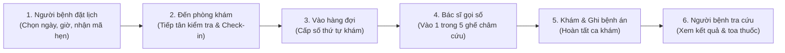

# 🏥 HỆ THỐNG QUẢN LÝ VÀ TIẾP NHẬN BỆNH NHÂN - PHÒNG KHÁM CHÚC TỪ

> **Chuc Tu Traditional Medicine Clinic Management System**  
> Nền tảng tiếp nhận đặt lịch khám bệnh, điều phối phòng chờ và quản trị bệnh án cho Phòng Khám Y học Cổ truyền Chúc Từ (Châm cứu, Bấm huyệt, Phục hồi chức năng).

---

## 📖 MỤC LỤC
1. [Triết lý thiết kế (Elderly-First UX)](#1-triết-lý-thiết-kế-elderly-first-ux)
2. [Kiến trúc & Công nghệ](#2-kiến-trúc--công-nghệ)
3. [🚀 HƯỚNG DẪN CHẠY BẰNG DOCKER (KHUYÊN DÙNG - 1 LỆNH)](#3--hướng-dẫn-chạy-bằng-docker-khuyên-dùng---1-lệnh)
4. [💻 Hướng dẫn chạy thủ công (Local Development)](#4--hướng-dẫn-chạy-thủ-công-local-development)
5. [🔑 Danh sách tài khoản kiểm thử sẵn có](#5--danh-sách-tài-khoản-kiểm-thử-sẵn-có)
6. [🔄 Luồng vận hành chính của phòng khám](#6--luồng-vận-hành-chính-của-phòng-khám)
7. [🛠️ Khắc phục sự cố thường gặp (Troubleshooting)](#7-️-khắc-phục-sự-cố-thường-gặp-troubleshooting)

---

## 1. TRIẾT LÝ THIẾT KẾ: ELDERLY-FIRST UX

Dành riêng cho đối tượng người bệnh lớn tuổi (50–80 tuổi) mắt kém, tay run:
- **Cỡ chữ lớn & Dễ đọc**: Văn bản thông thường (body text) tối thiểu `18px - 20px`, tiêu đề `24px - 32px`.
- **Tông màu Thảo mộc & Gỗ trầm (Warm Herbal)**: 
  - Nâu gỗ trầm (`#5C3A21` / `#78350F`): Biểu trưng cho bàn bắt mạch, tủ thuốc đông y.
  - Xanh thảo mộc (`#2D5A27` / `#15803D`): Biểu trưng cho cây thuốc nam và sự hồi phục.
  - Vàng rơm ấm (`#D97706` / `#F59E0B`): Nút hành động quan trọng, cảnh báo.
  - Nền ngà ấm (`#FDFBF7`): Tương phản WCAG AAA (> 7:1), dịu mắt, không dùng màu trắng toát bệnh viện sắc lạnh.
- **Không hiệu ứng rối mắt**: Không dùng chữ trượt bay hay popup nhảy bất ngờ.
- **Mobile-First Sticky Bar**: 2 nút to cố định dưới chân màn hình điện thoại:
  - 📞 **Nút Hotline**: Bấm gọi trực tiếp bác sĩ (`tel:...`).
  - 📍 **Nút Chỉ đường**: Mở thẳng Google Maps dẫn đường đến phòng khám (Điện Biên Phủ, TP.HCM).

---

## 2. KIẾN TRÚC & CÔNG NGHỆ

```text
chuc-tu-clinic-system/
├── frontend/           # React 18 (Vite) + Tailwind CSS + Nginx Reverse Proxy
├── backend/            # Java 17 + Spring Boot 4 (Clean Layered Architecture)
├── database/           # Bộ script MySQL 8.0 migrations (001 - 006)
├── docker/mysql/init/  # 8 file SQL tự động nạp khi container khởi tạo lần đầu
├── docs/               # OpenAPI spec (openapi-v1.yaml), smoke-test.http, changelog
├── docker-compose.yml  # File điều phối chạy 3 container (MySQL, Backend, Frontend)
└── README.md           # Tài liệu hướng dẫn sử dụng (File này)
```

| Thành phần | Công nghệ | Cổng mặc định | Vai trò |
| :--- | :--- | :--- | :--- |
| **Frontend** | React 18, Vite, Nginx | `3000` | Giao diện người bệnh & Bàn làm việc nội bộ |
| **Backend** | Spring Boot 4, Java 17 | `4000` | REST API `/api/v1/**`, Spring Security JWT, Jackson 3 |
| **Database** | MySQL 8.0 InnoDB | `3307` (host) / `3306` (in-net) | 27 bảng dữ liệu, Charset `utf8mb4_unicode_ci` |

---

## 3. 🚀 HƯỚNG DẪN CHẠY BẰNG DOCKER (KHUYÊN DÙNG - 1 LỆNH)

> **Yêu cầu máy tính:**  
> - Đã cài đặt và đang mở **[Docker Desktop](https://www.docker.com/products/docker-desktop/)** (icon cá voi góc màn hình báo màu xanh *Running*).  
> - **KHÔNG CẦN** cài đặt Java, Maven, Node.js hay MySQL trên máy thật.

### Bước 1: Tải mã nguồn về máy
Mở Terminal / PowerShell trên máy tính:
```powershell
git clone -b feat/clinic-management-system https://github.com/tritrongpham0513/chuc-tu-clinic-system.git
cd chuc-tu-clinic-system
```

### Bước 2: Khởi chạy toàn bộ hệ thống
```powershell
docker compose up --build -d
```
*(Lần đầu chạy, Docker sẽ tải image và build các service trong khoảng 1–2 phút. Các lần sau khởi động chỉ mất vài giây).*

### Bước 3: Kiểm tra trạng thái các dịch vụ
```powershell
docker compose ps
```
Khi thấy cả 3 container `chuctupk-mysql`, `chuctupk-backend`, `chuctupk-frontend` đều ở trạng thái `healthy` hoặc `Up`, bạn có thể mở trình duyệt:

---

### 🌐 Các địa chỉ truy cập hệ thống

| Phân hệ | Đường dẫn (URL) | Mô tả |
| :--- | :--- | :--- |
| 🧑‍⚕️ **Cổng Người bệnh** | [http://localhost:3000](http://localhost:3000) | Đặt lịch hẹn, tra cứu phiếu khám, xem cẩm nang sức khỏe |
| 🏥 **Bàn làm việc Nội bộ** | [http://localhost:3000/noi-bo/](http://localhost:3000/noi-bo/) | Dành cho Bác sĩ, Tiếp tân, Quản trị viên |
| 📋 **Tài liệu Swagger API** | [http://localhost:4000/swagger-ui.html](http://localhost:4000/swagger-ui.html) | Danh mục chi tiết 45+ REST endpoints |
| 🩺 **Kiểm tra trạng thái API**| [http://localhost:4000/api/v1/health](http://localhost:4000/api/v1/health) | Trả về JSON trạng thái hệ thống |
| 🗄️ **Cơ sở dữ liệu MySQL** | Cổng `3307` | Host: `localhost`, User: `root`, Password: `root`, DB: `phongkham_chuctu` |

---

### 🛑 Các lệnh quản lý Docker hữu ích

```powershell
# Xem log thời gian thực của toàn bộ hệ thống:
docker compose logs -f

# Xem riêng log của backend:
docker compose logs -f backend

# Dừng toàn bộ hệ thống (giữ nguyên dữ liệu khám bệnh):
docker compose down

# Xóa sạch container và database để làm lại từ đầu:
docker compose down -v
```

---

## 4. 💻 HƯỚNG DẪN CHẠY THỦ CÔNG (LOCAL DEVELOPMENT)

Áp dụng khi bạn muốn lập trình và sửa code trực tiếp trên máy tính mà không qua Docker.

### Yêu cầu môi trường:
- Java JDK 17+
- Node.js 18+ (khuyên dùng Node 20/22)
- MySQL 8.0+ đang chạy ở cổng 3306

### Bước 1: Khởi tạo Database
1. Tạo database:
   ```sql
   CREATE DATABASE phongkham_chuctu CHARACTER SET utf8mb4 COLLATE utf8mb4_unicode_ci;
   ```
2. Chạy lần lượt các script trong thư mục `database/` hoặc `docker/mysql/init/` từ `01` đến `08`.

### Bước 2: Chạy Backend (Port 4000)
1. Tạo file `backend/.env` từ file mẫu:
   ```powershell
   # Điền mật khẩu MySQL của máy bạn vào DB_PASSWORD
   PORT=4000
   DB_URL=jdbc:mysql://localhost:3306/phongkham_chuctu?useSSL=false&serverTimezone=Asia/Ho_Chi_Minh&allowPublicKeyRetrieval=true
   DB_USERNAME=root
   DB_PASSWORD=your_password
   ```
2. Khởi động Backend:
   ```powershell
   cd backend
   .\mvnw.cmd spring-boot:run
   ```

### Bước 3: Chạy Frontend (Port 5173)
Mở cửa sổ Terminal thứ 2:
```powershell
cd frontend
npm install
npm run dev
```
Trình duyệt mở tại: `http://localhost:5173` (Vite Proxy sẽ tự động chuyển các request `/api/v1/**` sang backend cổng 4000).

---

## 5. 🔑 DANH SÁCH TÀI KHOẢN KIỂM THỬ SẴN CÓ

Hệ thống đã nạp sẵn các tài khoản mẫu để bạn có thể đăng nhập kiểm thử ngay mà không cần tạo mới:

### 1. Phân hệ Nội bộ (Đăng nhập tại `http://localhost:3000/noi-bo/`)
| Vai trò | Tên đăng nhập | Email | Mật khẩu mặc định | Quyền hạn chính |
| :--- | :--- | :--- | :--- | :--- |
| **Quản trị viên (ADMIN)** | `admin` | `admin@chuctu.vn` | `ChucTu@2026` | Toàn quyền: Quản lý tài khoản, duyệt bài viết, xem dashboard thống kê |
| **Bác sĩ (DOCTOR)** | `bacsi` | `bsnam@chuctu.vn` | `ChucTu@2026` | Gọi số khám, chẩn đoán, kê đơn, ghi nhận bệnh án |
| **Tiếp tân (STAFF / RECEPTIONIST)** | `letan` | `letan@chuctu.vn` | `ChucTu@2026` | Tiếp đón, check-in bệnh nhân, xếp vào hàng đợi, đổi lịch hẹn |

### 2. Cổng Người bệnh (Đăng nhập tại `http://localhost:3000/dang-nhap` hoặc khi Đặt lịch)
- **Số điện thoại**: Bất kỳ số điện thoại hợp lệ tại Việt Nam (Ví dụ: `0987654321`, `0912345678`, `0901234567`).
- **Mã OTP xác thực (Môi trường Dev)**: Nhập mã cố định `123456` để đăng nhập ngay mà không cần gửi SMS thật.

---

## 6. 🔄 LUỒNG VẬN HÀNH CHÍNH CỦA PHÒNG KHÁM



1. **Khái niệm 5 ghế khám (`appointment_seats`)**:
   - Phòng khám có 5 ghế vật lý phục vụ bệnh nhân cùng lúc (châm cứu, bấm huyệt, chiếu đèn hồng ngoại theo liệu trình ~45–60 phút).
   - Hệ thống tự động khóa chỗ (Pessimistic Locking + Idempotency) nhằm loại bỏ 100% tình trạng đặt trùng lịch (double booking) dù có hàng chục người cùng thao tác đồng thời.
2. **Hàng đợi khám (`checkins`)**:
   - Khi tiếp tân bấm Check-in, bệnh nhân được xếp vào danh sách chờ theo 2 nhóm ưu tiên (`PRIORITY`: người già yếu, khuyết tật / `NORMAL`: thông thường).
   - Màn hình Bác sĩ sẽ tự động gợi ý người bệnh tiếp theo khi có ghế trống.

---

## 7. 🛠️ KHẮC PHỤC SỰ CỐ THƯỜNG GẶP (TROUBLESHOOTING)

### 1. Lỗi: `open //./pipe/dockerDesktopLinuxEngine: The system cannot find the file specified`
- **Nguyên nhân**: Docker Desktop trên máy bạn chưa được bật hoặc đang trong quá trình khởi động.
- **Cách xử lý**: Mở ứng dụng Docker Desktop từ Start Menu, đợi khoảng 20-30 giây cho biểu tượng ở góc dưới chuyển sang màu xanh lá (*Engine running*), sau đó chạy lại lệnh.

### 2. Lỗi cổng đang bị chiếm dụng (Port Conflict)
- Nếu cổng `3000` (frontend), `4000` (backend) hoặc `3307` (MySQL) trùng với ứng dụng khác trên máy bạn:
- Mở file `docker-compose.yml` và đổi cổng ở phần `ports:`:
  ```yaml
  ports:
    - "3001:80"    # Đổi cổng frontend từ 3000 thành 3001
    - "4001:4000"  # Đổi cổng backend từ 4000 thành 4001
  ```

### 3. Cần làm mới lại toàn bộ dữ liệu từ đầu (Reset Database)
Nếu muốn xóa hết dữ liệu cũ và nạp lại từ các file SQL khởi tạo:
```powershell
docker compose down -v
docker compose up --build -d
```

### 4. Xem mã nguồn chi tiết
- Backend Spring Boot: [backend/](file:///d:/clinic-management-system/backend)
- Frontend React Vite: [frontend/](file:///d:/clinic-management-system/frontend)
- Đặc tả API chi tiết: [docs/openapi-v1.yaml](file:///d:/clinic-management-system/docs/openapi-v1.yaml)
