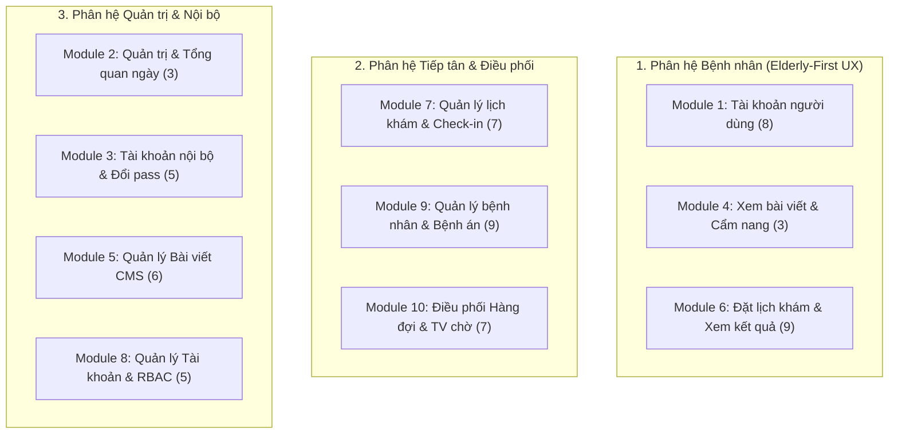

# 📋 BỘ PROMPT CHUẨN HÓA LẬP TRÌNH API & GIAO DIỆN (FRONTEND + BACKEND)
## DỰ ÁN PHÒNG KHÁM ĐÔNG Y CHÚC TỪ
> **Căn cứ nghiệp vụ**: File đặc tả `SEP_Nhom06_FunctionList_ver1.0_Done.xlsx` (62 chức năng / 10 Module)  
> **Quy chuẩn kiến trúc & UX**: `AGENTS.md` và `docs/PROJECT_CONTEXT.md`

---

## 🏛️ TỔNG QUAN HỆ THỐNG 10 MODULE (62 CHỨC NĂNG)



---

## 🧭 CẤU TRÚC CHUẨN CỦA MỘT PROMPT CODE CHUYÊN NGHIỆP

Mỗi prompt trong bộ này được đóng gói theo công thức **CRISP-Dev** (Context - Role - Input - Spec - Production Standards):
1. **Role & Context**: Khai báo vai trò (Senior Fullstack / Frontend / Backend Engineer) và ngữ cảnh phòng khám đông y Chúc Từ.
2. **Nghiệp vụ chi tiết**: Mã Function ID từ file Excel (`F.x.y`), luồng người dùng (Actor), điều kiện ràng buộc.
3. **Tiêu chuẩn Backend (Java Spring Boot 3)**: Endpoint RESTful, DTO validate, Transactional, RBAC Security, cấu trúc trả về `ApiResponse<T>`.
4. **Tiêu chuẩn Frontend (React 18 + Vite + Tailwind)**: Tuân thủ **Elderly-First UX** (nền ngà `#FDFBF7`, chữ nâu gỗ `#5C3A21`, xanh lá `#2D5A27`, font >= 18px, nút bấm >= 48px, không hiệu ứng giật mắt).

---

# PHẦN 1: BỘ PROMPT CHO PHÂN HỆ BỆNH NHÂN (ELDERLY-FIRST UX)

### Prompt 1.1: Quản lý Hồ sơ khám gia đình (Module 1 - F.1.6, F.1.7, F.1.8)

```markdown
Bạn là Kỹ sư Fullstack phụ trách phát triển tính năng "Quản lý Hồ sơ khám cá nhân và người thân" cho dự án Phòng Khám Chúc Từ.
Căn cứ tài liệu đặc tả: Function ID F.1.6, F.1.7, F.1.8 (Module 1).

### 1. Yêu cầu Nghiệp vụ:
- Mỗi tài khoản Bệnh nhân (Patient) có 1 hồ sơ chính chủ (tạo từ lúc đăng ký).
- Bệnh nhân có thể thêm/sửa tối đa 10 hồ sơ khám cho bản thân và người thân (ông bà, cha mẹ, con cái...).
- Thông tin mỗi hồ sơ: Họ tên, Số điện thoại liên hệ, Ngày sinh, Giới tính, Quan hệ với chủ tài khoản (Bản thân, Cha, Mẹ, Vợ/Chồng, Con, Khác), Tỉnh/Thành, Phường/Xã, Địa chỉ cụ thể.
- Ràng buộc xoá (F.1.8):
  + Hồ sơ chính chủ tuyệt đối KHÔNG ĐƯỢC XOÁ.
  + Nếu hồ sơ người thân ĐÃ CÓ LỊCH SỬ KHÁM: chỉ ngắt liên kết (unlink) khỏi tài khoản để bảo toàn dữ liệu y tế, không xoá cứng trong DB.
  + Nếu hồ sơ chưa từng phát sinh phiếu khám: cho phép xoá mềm (is_active = false).

### 2. Yêu cầu Backend (Java 17, Spring Boot 3):
- Entity ánh xạ: `Patient` và bảng liên kết `UserPatient` hoặc `relationship`.
- Viết REST Controller `/api/v1/patient-profiles`:
  + `GET /api/v1/patient-profiles`: Lấy danh sách tối đa 10 hồ sơ kèm cờ `isPrimary`.
  + `GET /api/v1/patient-profiles/{id}`: Xem chi tiết 1 hồ sơ.
  + `POST /api/v1/patient-profiles`: Tạo hồ sơ người thân (validate tối đa 10 hồ sơ/tài khoản).
  + `PUT /api/v1/patient-profiles/{id}`: Cập nhật thông tin hồ sơ.
  + `DELETE /api/v1/patient-profiles/{id}`: Xử lý xoá/ngắt liên kết theo đúng quy tắc nghiệp vụ.
- Bảo mật: Xác thực qua JWT Bearer Token, chỉ chủ sở hữu mới có quyền đọc/ghi hồ sơ của mình.
- Định dạng dữ liệu trả về chuẩn `ApiResponse<T>`.

### 3. Yêu cầu Frontend (React + Vite + Tailwind CSS):
- Tạo trang `/tai-khoan/ho-so-kham` và Modal/Form Thêm/Sửa hồ sơ.
- Tuân thủ nghiêm ngặt quy tắc người cao tuổi (AGENTS.md):
  + Cỡ chữ tối thiểu 18px, tiêu đề 24px-28px. Nền ngà ấm `#FDFBF7`, viền bo tròn nhẹ, độ tương phản cao.
  + Nút "Thêm hồ sơ người thân" to rõ (chiều cao >= 52px), icon dễ hiểu.
  + Thẻ hiển thị hồ sơ có huy hiệu rõ ràng: [Chính chủ], [Cha], [Mẹ]...
  + Hộp thoại xác nhận xoá hiển thị chữ tiếng Việt giản dị, cảnh báo rõ ràng trước khi tách hồ sơ.
- Kết nối thông qua file api `src/api/patientProfile.js` dùng axios instance đã có.
```

---

### Prompt 1.2: Đặt lịch khám bệnh Online & Chọn khung giờ (Module 6 - F.6.1, F.6.2, F.6.3)

```markdown
Bạn là Kỹ sư Fullstack phát triển phân hệ cốt lõi "Đặt lịch khám trực tuyến" cho Phòng Khám Chúc Từ.
Căn cứ tài liệu đặc tả: Function ID F.6.1, F.6.2, F.6.3 (Module 6).

### 1. Yêu cầu Nghiệp vụ:
- Cho phép bệnh nhân đã đăng nhập đặt hẹn trước từ hôm nay đến 30 ngày tiếp theo.
- Khung giờ khám được chia theo ca sáng và ca chiều (mỗi khung 30-45 phút, ví dụ: 08:00 - 08:45, 08:45 - 09:30...).
- Giới hạn tải (Slot Quota): Tối đa 6 phiếu khám trên 1 khung giờ.
  + Khung giờ đã đủ 6 phiếu -> Báo "Đã đầy", khóa không cho chọn.
  + Khung giờ trong quá khứ hoặc đã bắt đầu trong ngày -> Khóa không cho chọn.
- Luồng 3 bước đặt lịch tối giản:
  + Bước 1: Chọn ngày khám & khung giờ khả dụng.
  + Bước 2: Chọn hồ sơ người khám (chính chủ hoặc người thân) + Chọn lý do/dịch vụ khám (Bắt mạch đông y, Châm cứu, Bấm huyệt, Phục hồi chức năng...).
  + Bước 3: Xác nhận thông tin -> Hệ thống tự động tạo mã phiếu khám (dạng PK-YYYYMMDD-XXXX) và giữ chỗ ngay lập tức mà KHÔNG CẦN TIẾP TÂN DUYỆT THỦ CÔNG.

### 2. Yêu cầu Backend (Java 17, Spring Boot 3, MySQL 8):
- Cơ chế chống Double-Booking (Concurrency Protection): Dùng `@Transactional` kết hợp kiểm tra số lượng phiếu đã đặt trong khung giờ (`countByAppointmentDateAndSlotId < 6`) với khóa bi-quan hoặc câu lệnh atomic UPDATE/INSERT.
- Viết REST API `/api/v1/appointments`:
  + `GET /api/v1/appointments/available-slots?date=YYYY-MM-DD`: Trả về danh sách khung giờ trong ngày kèm số ghế còn trống (remainingSlots / 6).
  + `POST /api/v1/appointments/booking`: Đặt lịch khám, trả về thông tin phiếu khám và mã QR tra cứu.
- Sinh mã phiếu `booking_code` tự động và lưu vết người đặt (`user_id`), bệnh nhân khám (`patient_id`).

### 3. Yêu cầu Frontend (React + Vite + Tailwind CSS):
- Tạo trang `/dat-lich-kham` với giao diện 3 bước dạng thanh tiến trình (Stepper) to, rõ ràng:
  + Bộ chọn ngày (Calendar) hiển thị font số lớn, các ngày mở cửa hiển thị xanh lá, ngày nghỉ hoặc hết chỗ hiển thị xám mờ.
  + Lưới chọn khung giờ: Mỗi ô giờ là một nút to (>= 60px chiều cao), hiển thị rõ: "08:00 - 08:45 (Còn 3 chỗ)".
  + Thẻ xác nhận cuối cùng tóm tắt to bản: Tên người khám, Ngày khám, Giờ hẹn, Lời nhắc mang theo CCCD và đến trước 10 phút.
  + Luôn hiển thị thanh cố định dưới đáy mobile: Nút Hotline và Hướng dẫn đường đi.
```

---

### Prompt 1.3: Quản lý Phiếu khám của tôi & Hủy lịch (Module 6 - F.6.4, F.6.5, F.6.6, F.6.7)

```markdown
Bạn là Kỹ sư Fullstack phát triển tính năng "Theo dõi phiếu khám và lịch sử khám" cho bệnh nhân tại Phòng Khám Chúc Từ.
Căn cứ tài liệu đặc tả: Function ID F.6.4, F.6.5, F.6.6, F.6.7 (Module 6).

### 1. Yêu cầu Nghiệp vụ:
- Bệnh nhân xem danh sách phiếu khám của mình và người thân.
- Bộ lọc trạng thái: "Sắp tới (Chờ khám)", "Đã hoàn thành", "Đã huỷ".
- Chi tiết phiếu khám: Mã phiếu, QR Code quét check-in, giờ hẹn, người khám, dịch vụ, hướng dẫn đường đi.
- Hủy phiếu (F.6.6):
  + Bệnh nhân chỉ được tự huỷ phiếu khi phiếu đang ở trạng thái `CHỜ_ĐẾN` (chưa check-in tại phòng khám).
  + Cho phép chọn lý do hủy (Bận việc đột xuất, Đã đỡ bệnh, Đặt nhầm giờ, Lý do khác).
  + Khi phiếu đã được Tiếp tân check-in -> Không cho phép tự huỷ trên web, hiển thị thông báo hướng dẫn liên hệ trực tiếp quầy tiếp tân.
- Đặt lại phiếu đã hủy (F.6.7): Nút "Đặt lại buổi khám này" giúp sao chép thông tin người khám và dịch vụ để chuyển nhanh sang màn hình chọn ngày giờ mới.

### 2. Yêu cầu Backend:
- Endpoints:
  + `GET /api/v1/my-appointments`: Phân trang, lọc theo trạng thái.
  + `GET /api/v1/my-appointments/{id}`: Chi tiết phiếu.
  + `POST /api/v1/my-appointments/{id}/cancel`: Hủy phiếu (kèm `cancellationReason`).
- Ràng buộc: Kiểm tra nghiêm ngặt `status == PENDING_ARRIVAL` trước khi chuyển sang `CANCELLED`.

### 3. Yêu cầu Frontend:
- Trang `/tai-khoan/phieu-kham` chia 2 tab to bản: [Phiếu sắp tới] và [Lịch sử khám cũ].
- Thẻ phiếu khám thiết kế như cuống vé đông y cổ điển (gam màu nâu gỗ ấm, mã phiếu in to đậm, có mã QR to ở giữa).
- Modal hủy lịch: Chữ to rõ, nút "Giữ lại lịch" màu nổi bật hơn nút "Xác nhận hủy" để tránh người già bấm nhầm.
```

---

# PHẦN 2: BỘ PROMPT CHO PHÂN HỆ TIẾP TÂN & ĐIỀU PHỐI (RECEPTIONIST & CLINIC OPS)

### Prompt 2.1: Tiếp nhận / Check-in & Đặt hộ tại quầy (Module 7 - F.7.1 -> F.7.7)

```markdown
Bạn là Kỹ sư Fullstack phát triển phân hệ "Bàn tiếp tân phòng khám (Receptionist Desk)" cho Phòng Khám Chúc Từ.
Căn cứ tài liệu đặc tả: Module 7 (F.7.1 đến F.7.7).

### 1. Yêu cầu Nghiệp vụ:
- Giao diện thao tác tốc độ cao, hỗ trợ phím tắt cho nhân viên tiếp tân.
- Xem lịch khám trong ngày hôm nay, tự động chia theo các khung giờ.
- Thanh tìm kiếm tức thời (Debounce search): Quét mã vạch/mã QR hoặc gõ số điện thoại, mã phiếu khám, tên bệnh nhân để ra kết quả dưới 200ms.
- Tác vụ Check-in (F.7.3):
  + Bấm nút "Tiếp nhận" -> Ghi nhận thời điểm đến, chuyển trạng thái sang `CHECKED_IN`, tự động đưa vào Hàng đợi khám.
  + Quy tắc giờ nhận bệnh: Chỉ cho phép check-in trong khung giờ mở cửa tiếp nhận (08:00 - 16:30).
  + Cho phép "Hoàn tác check-in" (F.7.4) trong trường hợp bấm nhầm.
- Đặt hộ tại quầy (F.7.5): Dành cho cụ già đến thẳng phòng khám không biết dùng điện thoại.
  + Nhập nhanh SĐT/Họ tên -> Tìm xem đã có hồ sơ chưa. Nếu có thì dùng lại, nếu chưa thì tạo nhanh hồ sơ mới.
  + Xếp vào khung giờ còn trống trong ngày và tự động check-in luôn vào hàng đợi.

### 2. Yêu cầu Backend (Spring Boot 3, Java 17):
- Controller `/api/v1/reception/appointments`:
  + `GET /today`: Lấy danh sách phiếu hôm nay kèm số liệu thống kê nhanh (Tổng số, Chưa đến, Đã check-in, Đã vào khám, Hoàn tất).
  + `POST /{id}/check-in`: Thực hiện check-in, cập nhật `check_in_time = NOW()`.
  + `POST /{id}/undo-check-in`: Hoàn tác check-in về `PENDING_ARRIVAL`.
  + `POST /walk-in`: Đặt lịch khám trực tiếp tại quầy và auto check-in.
  + `PUT /{id}/reschedule`: Đổi ngày và khung giờ khám cho bệnh nhân.
- Bảo mật: Yêu cầu quyền `ROLE_RECEPTIONIST` hoặc `ROLE_ADMIN`.

### 3. Yêu cầu Frontend (React + Vite + Tailwind CSS):
- Tạo trang Quản trị tiếp tân: `/admin/tiep-nhan`.
- Bảng danh sách trực quan, độ tương phản sắc nét, có màu phân loại trạng thái:
  + Xám: Chưa đến | Xanh dương: Đã check-in (Đang chờ) | Cam: Đang trong phòng khám | Xanh lá: Đã xong.
- Nút "TIẾP NHẬN" màu xanh lá to nổi bật tại mỗi dòng, có thể nhấn phím cách (Space) hoặc Enter để thao tác nhanh.
- Modal "Đặt lịch tại quầy" tối ưu số lượng trường nhập, tự động gợi ý địa phương TP.HCM.
```

---

### Prompt 2.2: Điều phối Hàng đợi khám & Màn hình TV phòng chờ (Module 10 - F.10.1 -> F.10.7)

```markdown
Bạn là Kỹ sư Fullstack phát triển phân hệ "Điều phối hàng đợi khám bệnh & Hiển thị TV phòng chờ" cho Phòng Khám Chúc Từ.
Căn cứ tài liệu đặc tả: Module 10 (F.10.1 đến F.10.7).

### 1. Yêu cầu Nghiệp vụ:
- Phòng khám có năng lực phục vụ đồng thời tối đa 5 GHẾ KHÁM/CHÂM CỨU trong cùng một thời điểm.
- Hàng đợi bệnh nhân chia làm 2 luồng:
  + Luồng Ưu tiên (Người già > 80 tuổi, người khuyết tật, bệnh nhân nặng).
  + Luồng Tiêu chuẩn (Thứ tự theo giờ check-in thực tế).
- Tác vụ Điều phối (F.10.2, F.10.3, F.10.4):
  + Khi có ghế trống (ít hơn 5 người đang khám): Bấm "Mời vào khám" -> Lấy người đầu hàng đợi vào ghế trống, ghi nhận `started_at = NOW()`.
  + Có chế độ "Bật/Tắt tự động mời người tiếp theo" khi có ghế hoàn tất.
  + Nút "Hoàn tất khám" -> Mở modal ghi nhận kết quả khám và giải phóng ghế.
- Màn hình TV phòng chờ (F.10.7):
  + Đường dẫn độc lập `/tv-phong-cho` không có thanh menu quản trị, hiển thị toàn màn hình (Fullscreen).
  + Giao diện chữ siêu to, hiển thị 2 cột: [ĐANG ĐƯỢC KHÁM - 5 GHẾ] và [CHUẨN BỊ VÀO KHÁM - 5 NGƯỜI KẾ TIẾP].
  + Tự động làm mới dữ liệu mỗi 5 giây (Polling hoặc WebSocket).
  + Khi có bệnh nhân mới được mời vào ghế: Phát âm thanh chuông "Ting ting" và nhấp nháy dòng tên bệnh nhân để người nhà chú ý.

### 2. Yêu cầu Backend:
- Service `QueueManagementService` quản lý trạng thái luân chuyển 5 ghế:
  + Quản lý trạng thái: `WAITING` -> `IN_CONSULTATION` -> `COMPLETED`.
  + Xếp thứ tự hàng chờ: `ORDER BY is_priority DESC, check_in_time ASC`.
- Endpoints:
  + `GET /api/v1/queue/live`: Trả về dữ liệu 5 ghế đang khám và danh sách chờ.
  + `POST /api/v1/queue/call-next`: Gọi bệnh nhân tiếp theo vào ghế trống cụ thể (Ghế 1..5).
  + `POST /api/v1/queue/{appointmentId}/undo-call`: Hoàn tác bệnh nhân quay lại hàng chờ.
  + `GET /api/v1/public/tv-queue`: Endpoint công khai tốc độ cao không cần xác thực để màn hình TV gọi định kỳ.

### 3. Yêu cầu Frontend:
- Tạo 2 trang:
  1. Trang điều phối bác sĩ: `/admin/hang-doi` (Trực quan hóa sơ đồ 5 ghế khám, kéo thả hoặc nút bấm mời vào/hoàn tất).
  2. Trang TV phòng chờ: `/tv-phong-cho` (Thiết kế nền tối sang trọng hoặc nền gỗ ấm, chữ font 32px-48px rõ ràng từ khoảng cách xa 5 mét, tích hợp âm thanh Web Audio API / Audio element thông báo).
```

---

### Prompt 2.3: Bệnh án điện tử & Ghi nhận lượt khám (Module 9 - F.9.1 -> F.9.9)

```markdown
Bạn là Kỹ sư Fullstack phát triển phân hệ "Quản lý Bệnh nhân & Bệnh án Đông y (Medical Records)" cho Phòng Khám Chúc Từ.
Căn cứ tài liệu đặc tả: Module 9 (F.9.1 đến F.9.9).

### 1. Yêu cầu Nghiệp vụ:
- Quản lý danh sách bệnh nhân: Tìm kiếm theo Mã bệnh nhân (BN-XXXXXX), Họ tên, Số điện thoại.
- Hồ sơ chi tiết bệnh nhân: Thông tin nhân thân, tiền sử bệnh lý, dị ứng, danh sách tất cả các buổi khám trong quá khứ.
- Lập phiếu kết quả khám (F.9.7):
  + Thông số khám đông y: Tứ chẩn (Vọng, Văn, Vấn, Thiết), Mạch (Phù, Trầm, Trì, Sác...), Huyết áp, Nhiệt độ.
  + Chẩn đoán đông y (Chứng trạng, Bát cương) & Chẩn đoán tây y kèm theo.
  + Phương pháp điều trị: Châm cứu (các huyệt đạo), Bấm huyệt, Xoa bóp, Cứu ngải, Thuốc thang đông y.
  + Lời dặn dò dưỡng sinh, ăn uống và ngày hẹn tái khám.
- Ràng buộc sửa phiếu kết quả (F.9.9):
  + Chỉ cho phép bác sĩ / tiếp tân chỉnh sửa phiếu trong vòng 24 GIỜ sau khi lập.
  + Quá 24 giờ phiếu bị khóa cứng; nếu cần sửa phải có quyền Admin duyệt và hệ thống ghi lại nhật ký (Audit Log) ai sửa, sửa nội dung gì lúc nào.

### 2. Yêu cầu Backend (Spring Boot 3, JPA, MySQL 8):
- Bảng cơ sở dữ liệu: `medical_records`, `treatment_details`, `audit_logs`.
- Endpoints `/api/v1/medical-records`:
  + `GET /patient/{patientId}`: Lấy toàn bộ lịch sử bệnh án của bệnh nhân.
  + `POST /`: Lưu kết quả khám và cập nhật phiếu khám sang `COMPLETED`.
  + `PUT /{id}`: Sửa phiếu khám (kiểm tra điều kiện `created_at >= NOW() - 24 HOURS`).
  + `GET /{id}/print`: Xuất dữ liệu phiếu khám định dạng chuẩn in A4 / A5 gửi cho người bệnh mang về.

### 3. Yêu cầu Frontend:
- Trang `/admin/benh-nhan` và `/admin/benh-nhan/:id`.
- Form nhập kết quả khám thiết kế khoa học: Các ô thông số mạch, huyết áp có gợi ý nhanh; danh sách huyệt châm cứu có thể tích chọn nhanh; hỗ trợ in phiếu kết quả bằng phím `Ctrl + P` định dạng tem/giấy khám đông y trang trọng.
```

---

# PHẦN 3: BỘ PROMPT CHO PHÂN HỆ QUẢN TRỊ & NỘI BỘ (ADMIN & CMS)

### Prompt 3.1: Quản lý Bài viết & Cẩm nang Y học Cổ truyền (Module 5 - F.5.1 -> F.5.6)

```markdown
Bạn là Kỹ sư Fullstack phát triển phân hệ "CMS Quản lý bài viết & Cẩm nang sức khỏe" cho Phòng Khám Chúc Từ.
Căn cứ tài liệu đặc tả: Module 5 (F.5.1 đến F.5.6) và Module 4 (F.4.1 - F.4.3).

### 1. Yêu cầu Nghiệp vụ:
- Bài viết phân theo chuyên mục: Dưỡng sinh người cao tuổi, Bài thuốc nam quanh nhà, Châm cứu bấm huyệt, Hoạt động thiện nguyện phòng khám.
- Trình soạn thảo văn bản giàu (Rich Text Editor):
  + Hỗ trợ tiêu đề, in đậm, chèn ảnh, trích dẫn lời khuyên bác sĩ.
  + Cho phép tải ảnh đại diện bài viết (Thumbnail), tự động nén tối ưu WebP.
  + Hỗ trợ lưu bản nháp (Draft), hẹn giờ đăng hoặc Đăng ngay (Published).
  + Chức năng xem trước (Preview) giao diện thực tế trước khi xuất bản.
- Ghim bài viết (F.5.6): Admin có thể ghim 1 bài viết quan trọng lên đầu trang chủ/cẩm nang; mỗi thời điểm chỉ có DUY NHẤT 1 BÀI ĐƯỢC GHIM (bài mới ghim sẽ tự bỏ ghim bài cũ).
- Bảo vệ 4 trang cố định (F.5.2, F.5.3): Bốn trang [Giới thiệu], [Dịch vụ], [Hướng dẫn đặt lịch], [Liên hệ & Bản đồ] có thể sửa nội dung nhưng KHÔNG THỂ XÓA.

### 2. Yêu cầu Backend:
- Entity `Article`: `id`, `title`, `slug`, `category`, `summary`, `content`, `thumbnail_url`, `is_pinned`, `is_system_page`, `status` (DRAFT, PUBLISHED), `view_count`, `author_id`.
- Endpoints:
  + Public: `GET /api/v1/articles` (phân trang, lọc theo category, bài ghim lên đầu), `GET /api/v1/articles/{slug}`.
  + Admin: `POST /api/v1/admin/articles`, `PUT /api/v1/admin/articles/{id}`, `DELETE /api/v1/admin/articles/{id}`, `PATCH /api/v1/admin/articles/{id}/pin`.

### 3. Yêu cầu Frontend:
- Phía Public: Trang `/cam-nang-suc-khoe` và `/bai-viet/:slug` chữ to rõ ràng, hình ảnh minh họa chân thực ấm cúng, có nút chia sẻ Zalo/Facebook và nút gọi Hotline dưới chân bài viết.
- Phía Admin: Trang `/admin/bai-viet` và `/admin/bai-viet/soan-thao` tích hợp trình soạn thảo (TipTap hoặc Quill), danh sách bài viết có nút ghim bài nhanh và xem thống kê lượt đọc.
```

---

### Prompt 3.2: Quản lý Tài khoản & Phân quyền RBAC (Module 8 - F.8.1 -> F.8.5)

```markdown
Bạn là Kỹ sư Fullstack phát triển phân hệ "Quản lý Tài khoản người dùng & Phân quyền bảo mật RBAC" cho Phòng Khám Chúc Từ.
Căn cứ tài liệu đặc tả: Module 8 (F.8.1 đến F.8.5).

### 1. Yêu cầu Nghiệp vụ:
- Hệ thống hỗ trợ 3 nhóm vai trò (Roles):
  1. `ROLE_PATIENT`: Bệnh nhân (đăng nhập bằng SĐT + OTP).
  2. `ROLE_RECEPTIONIST`: Nhân viên tiếp tân (đăng nhập bằng SĐT/Email + Mật khẩu).
  3. `ROLE_ADMIN`: Quản trị viên phòng khám (toàn quyền hệ thống).
- Danh sách tài khoản: Tìm kiếm theo họ tên, SĐT, email; lọc theo vai trò và trạng thái Hoạt động / Đang khóa.
- Thêm tài khoản nội bộ (F.8.2): Admin tạo tài khoản cho bác sĩ/tiếp tân kèm mật khẩu tạm thời. Lần đầu đăng nhập bắt buộc đổi mật khẩu.
- Khóa / Mở khóa tài khoản (F.8.4): Khóa tài khoản khi vi phạm hoặc nhân viên nghỉ việc; tài khoản bị khóa không thể đăng nhập, nhưng các phiếu khám đã đặt vẫn được giữ nguyên tính toàn vẹn.
- Phân quyền (F.8.5): Admin có thể chuyển đổi vai trò của người dùng. Tài khoản admin gốc không được phép bị hạ quyền hoặc khóa.

### 2. Yêu cầu Backend:
- Spring Security 6 + JWT Stateless.
- Endpoints `/api/v1/admin/users`:
  + `GET /`: Phân trang danh sách tài khoản.
  + `POST /`: Tạo tài khoản nội bộ mới (băm mật khẩu bằng BCrypt).
  + `PUT /{id}`: Sửa thông tin tài khoản.
  + `PATCH /{id}/status`: Đổi trạng thái `ACTIVE` <-> `LOCKED`.
  + `PATCH /{id}/role`: Thay đổi Role người dùng.
- Ghi log bảo mật khi có thao tác thay đổi quyền hoặc khóa tài khoản.

### 3. Yêu cầu Frontend:
- Trang `/admin/tai-khoan`: Bảng dữ liệu sạch sẽ, rõ ràng.
- Huy hiệu vai trò nổi bật: [Quản trị viên - Đỏ], [Tiếp tân - Xanh dương], [Bệnh nhân - Xanh lá].
- Nút khóa/mở khóa có màu cảnh báo trực quan và hiển thị xác nhận trước khi thực hiện.
```

---

### Prompt 3.3: Dashboard Tổng quan phòng khám trong ngày (Module 2 - F.2.3)

```markdown
Bạn là Kỹ sư Fullstack phát triển tính năng "Trang Tổng quan Hoạt động trong ngày (Daily Dashboard)" cho Phòng Khám Chúc Từ.
Căn cứ tài liệu đặc tả: Function ID F.2.3 (Module 2).

### 1. Yêu cầu Nghiệp vụ:
- Bảng điều khiển dành riêng cho Quản trị viên và Trưởng phòng khám để nắm bắt tức thì nhịp độ hoạt động trong ngày mà KHÔNG RỐI MẮT:
  + Thẻ số 1: Số phiếu khám hôm nay (Chưa đến, Đang chờ, Đang khám, Đã hoàn thành, Đã hủy).
  + Thẻ số 2: Tải ghế hiện tại (Số ghế đang bận / 5 ghế).
  + Thẻ số 3: Số hồ sơ bệnh nhân mới tạo trong tuần.
  + Thẻ số 4: Bài viết bản nháp chờ duyệt hoặc số bài đã xuất bản.
  + Biểu đồ trực quan: Sơ đồ phân bổ số lượng đặt khám theo từng khung giờ trong ngày hôm nay (giúp biết khung giờ nào cao điểm để điều phối bác sĩ châm cứu).

### 2. Yêu cầu Backend:
- Endpoint `GET /api/v1/admin/dashboard/today`: Trả về toàn bộ dữ liệu thống kê tổng hợp trong ngày bằng các câu truy vấn tối ưu (COUNT, GROUP BY slot_time), có cache nhẹ 30-60 giây để giảm tải DB.

### 3. Yêu cầu Frontend:
- Trang `/admin/tong-quan`: Thiết kế tinh gọn, thuần Việt, phong cách ấm áp (Warm Herbal & Wood).
- Các thẻ số liệu to rõ, màu sắc hài hòa. Biểu đồ cột biểu diễn các khung giờ từ 08:00 đến 17:00 trực quan, dễ nắm bắt.
```

